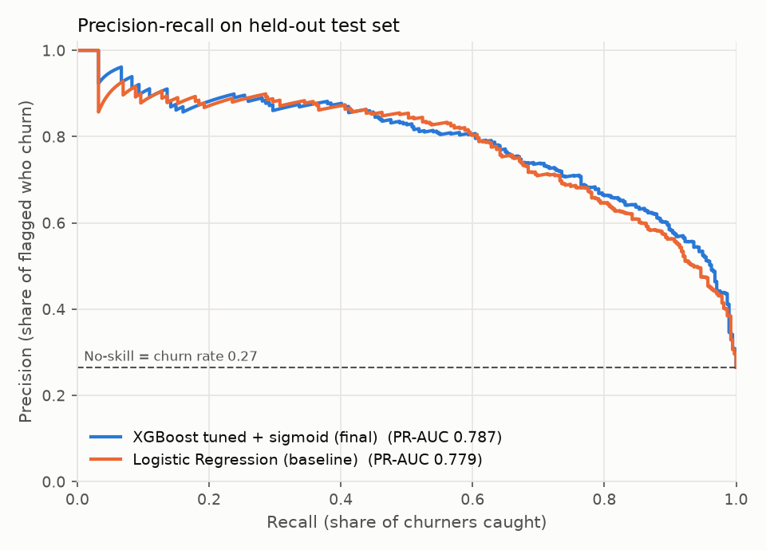
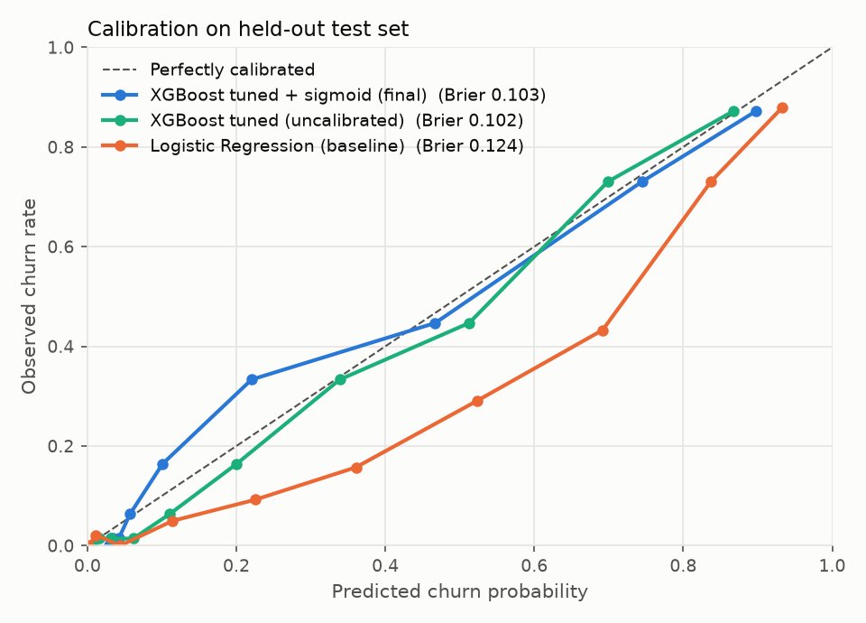
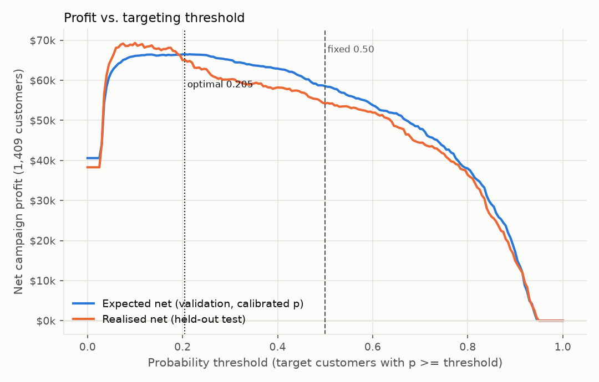

<!-- GENERATED FILE: edit docs/README.template.md, then run `python scripts/build_readme.py`. -->
# Explainable Churn & Retention ROI Decision System

[](LICENSE)

A decision system for a Customer Success team: not just *who* will churn, but *why*, and
*whether it is worth paying to keep them*. Calibrated risk scores feed plain-English SHAP
drivers, a profit-maximising targeting threshold, and a Streamlit app that drafts a tailored
retention offer per account.

## Business problem

A retention budget is finite. A churn classifier answers the first question (who is likely to
leave) but leaves the three that decide the outcome:

1. **Why is this customer at risk?** A rep needs a reason they can act on, not a probability.
2. **Who is worth contacting?** A fixed 0.50 cut-off ignores both the cost of an offer and the
   value of the customer.
3. **What do we say?** The offer should address the customer's actual drivers, within budget.

Data: IBM Telco customer churn (extended v11.1.3+ release), 7,043 customers,
26.5% churned in the last month, 37 model features after cleaning,
feature engineering and leakage removal.

## Key findings

- **Churn is concentrated.** Month-to-Month + Fiber Optic customers churn at 59%
  (1,882 customers), versus 2.5% on two-year contracts.
- **The tuned model is better calibrated, not clearly better at ranking.** XGBoost reaches
  PR-AUC 0.787 vs 0.779 for logistic regression. The PR-AUC gain is not distinguishable from noise, and the ROC-AUC gain is small but its interval excludes zero. The clear win is
  calibration: Brier 0.103 vs 0.124, which is what the ROI maths needs.
- **A profit-optimal threshold beats the 0.50 default.** At 0.205, realised net on the
  held-out test set is $65,089 vs $54,252 at 0.50 (+$10,836, 20%).
  Targeting everyone nets only $38,287.
- **The source data contains label-leaking columns**: a satisfaction survey and a prior
  model's churn score each reach about 0.95 AUC on their own. All were excluded (see
  [Limitations](#limitations--design-decisions)).
- **Stated churn reasons do not line up with account features** in this dataset, so the model
  cannot be validated against what customers said (see below).

## Baseline vs. final model

Held-out test set (1,409 customers). The split is stratified 4,225 / 1,409 /
1,409: the training split fits models and runs 50-trial Optuna tuning (5-fold CV,
PR-AUC objective); the validation split fits the `sigmoid` calibrator and picks
thresholds; the test split is used for reporting only. "Tuned thr" is the F1-best threshold
chosen on validation.

| Model | PR-AUC | ROC-AUC | Brier | Recall @0.50 | F1 @0.50 | Recall @tuned thr | F1 @tuned thr |
|---|---|---|---|---|---|---|---|
| Logistic Regression (baseline) | 0.779 | 0.908 | 0.124 | 0.842 | 0.707 | 0.735 | 0.714 |
| XGBoost tuned (uncalibrated) | 0.787 | 0.915 | 0.102 | 0.711 | 0.722 | 0.773 | 0.724 |
| **XGBoost tuned + sigmoid (final)** | 0.787 | 0.915 | 0.103 | 0.671 | 0.707 | 0.773 | 0.724 |

- **Final** = tuned XGBoost + `sigmoid` calibration. Baseline = class-weighted logistic
  regression.
- **Bootstrap difference, final minus baseline** (test set, 1,000 resamples):
  PR-AUC +0.008 (95% CI -0.011 to +0.027); ROC-AUC +0.007 (95% CI +0.001 to +0.014).
- **Recall at 0.50 is not comparable across the two rows**: class weighting inflates the
  baseline's scores (recall 0.84 at 0.50 vs 0.67 for the calibrated
  model). At each model's own validation-tuned threshold the recalls are 0.74 and
  0.77.
- Top-decile lift of the final model: 3.3x.
- Sigmoid calibration is used instead of isotonic: on a validation split this small, isotonic
  collapses scores into ties and lowers PR-AUC. Both are recorded in `artifacts/metrics.json`.




## Explainability

SHAP (`TreeExplainer`) runs on the tuned XGBoost; one-hot columns are summed back to their
original feature, and SHAP is additive to the model's log-odds (checked at runtime). Every
customer gets their top 3 *risk-raising* drivers in plain English.

| Feature | Mean abs SHAP | Share of total |
|---|---|---|
| `contract` | 0.867 | 22.8% |
| `number_of_referrals` | 0.551 | 14.5% |
| `tenure` | 0.324 | 8.5% |
| `number_of_dependents` | 0.226 | 6.0% |
| `monthly_charges` | 0.183 | 4.8% |
| `dependents` | 0.131 | 3.4% |

Example, rendered by the app's template engine:

Highest-risk current subscriber (`9605-WGJVW`, 94% churn probability, LTV $842):

1. Month-to-month contract (no lock-in)
2. Brand-new customer (1 month of tenure)
3. New month-to-month fiber customer

Template-engine offer within a $50 budget (est. cost $40): **1-year plan at 3% off + personal onboarding call + free speed & connection check**

> Hello, and thank you for being a customer. We would like to make your service work even better for you, and to say thanks we are offering 3% off your monthly bill for the next 12 months when you move to a 1-year plan, a personal call from your account team to make sure everything is set up the way you want and a free speed and connection check, with a priority repair slot if anything is off. This offer is open for the next 14 days: just reply to this message or call your account team and we will set it up.

### Do the drivers agree with what churners said?

Not in this dataset. For each stated churn category, the table shows how often the model's top 3
drivers include a feature that reason would plausibly touch (the feature mapping is a judgement
call in `src/explain.py`), against the same hit rate among churners who gave a *different*
reason. Lift near 1.0 means the drivers say nothing about the stated reason.

| Stated reason | Churners | Hit rate | Baseline (other churners) | Lift |
|---|---|---|---|---|
| Price | 211 | 0.39 | 0.34 | 1.14 |
| Competitor | 841 | 0.92 | 0.91 | 1.00 |
| Attitude | 314 | 0.01 | 0.02 | 0.79 |
| Dissatisfaction | 303 | 0.04 | 0.03 | 1.19 |

No account feature separates the stated-reason categories (every single-feature AUC is within
about 0.07 of chance), so this is a property of the data, not of the model. The high
"Competitor" hit rate is an artefact: contract and tenure appear in nearly every customer's
top 3, and the baseline column shows the same rate for everyone else. **Treat the drivers as
what the model learned about risk, not as validated explanations of customers' motives.**

## ROI impact

Assumptions (all configurable in `config/settings.yaml` and in the app's sliders): offer
cost $50 per targeted customer, 30% acceptance, LTV = `MonthlyCharges` x
expected remaining months (Month-to-Month 12, One Year 18, Two Year 30), mean LTV $1,164. The offer cost is charged for
every targeted customer, false positives included (conservative; switchable).

The threshold is chosen on the validation split from expected profit using calibrated
probabilities, then applied to the untouched test set with actual outcomes:

| Strategy | Targeted | Churners reached | Revenue saved | Campaign cost | Net ROI | ROI % |
|---|---|---|---|---|---|---|
| No campaign | 0 | 0 | $0 | $0 | $0 | – |
| Target everyone | 1,409 | 374 | $108,737 | $70,450 | $38,287 | 54% |
| Fixed threshold 0.50 | 336 | 251 | $71,052 | $16,800 | $54,252 | 323% |
| **Profit-optimal threshold 0.205** | 499 | 318 | $90,039 | $24,950 | $65,089 | 261% |
| Per-customer EV rule (upper bound) | 542 | 317 | $97,950 | $27,100 | $70,850 | 261% |

- The optimal threshold is **0.205**: it targets 499 customers vs
  336 at 0.50.
- Predicted net for the chosen threshold ($64,585) is close to the realised $65,089,
  which is the calibration paying off in dollars.
- "Per-customer EV rule" targets anyone whose expected return exceeds the offer cost. It is
  an upper bound; a single probability threshold cannot express it when LTV varies.
- Profit is a wide plateau across low thresholds, so the exact optimum is not fragile.



**The right threshold depends heavily on the economics.** Realised test-set net by offer cost
(rows) and acceptance rate (columns); `t` is the profit-optimal threshold:

| Offer cost \ acceptance | 10% | 30% | 50% |
|---|---|---|---|
| $25 | t=0.25: $17.0k (fixed 0.50: $15.3k) | t=0.06: $86.2k (fixed 0.50: $62.7k) | t=0.04: $154.4k (fixed 0.50: $110.0k) |
| $50 | t=0.52: $7.0k (fixed 0.50: $6.9k) | t=0.21: $65.1k (fixed 0.50: $54.3k) | t=0.09: $136.6k (fixed 0.50: $101.6k) |
| $100 | no campaign (fixed 0.50: -$9.9k) | t=0.42: $39.1k (fixed 0.50: $37.5k) | t=0.24: $97.4k (fixed 0.50: $84.8k) |
| $200 | no campaign (fixed 0.50: -$43.5k) | t=0.66: $8.7k (fixed 0.50: $3.9k) | t=0.43: $52.9k (fixed 0.50: $51.2k) |

When the offer is expensive and acceptance is low, no campaign pays off, and the fixed 0.50
rule would lose money. IBM's own `CLTV` column (mean around $4,400) makes almost any offer look
profitable and drives the threshold to near zero, so the default is the explicit
`MonthlyCharges` x months formula; `CLTV` is a config option.

## Quick start

```bash
make setup     # venv + dependencies (xgboost-cpu on Linux, no CUDA download)
make data      # download the IBM extended dataset (+ copy the 21-column fallback if present)
make train     # LR baseline vs tuned XGBoost -> SHAP drivers -> ROI threshold (artifacts/)
make app       # launch the Streamlit app
make test      # unit tests
make lint
```

Optional LLM-written offers: copy `.env.example` to `.env`, set `LLM_PROVIDER`
(`gemini` | `openai` | `anthropic`) and the matching API key. With no key the app uses the
deterministic template engine; it also falls back to the template if the model errors, times
out, picks an action that is not on the menu, exceeds the budget, or uses banned wording.
Prices are always computed in code, never by the model. The LLM path is covered by unit tests
with fake providers; live calls need your own key.

To use the original 21-column file instead, set `CHURN_DATA_SOURCE=kaggle_21`.

## The app

- **Executive Overview:** churn KPIs, a Contract x Internet Service risk heatmap, global SHAP.
- **ROI Simulator:** offer-cost and acceptance sliders update the optimal threshold, customers
  targeted and net dollars saved, with the full cost-benefit matrix.
- **At-Risk Account Explorer:** filter current subscribers, inspect a SHAP waterfall, and
  generate a retention offer (badge shows "Generated by: LLM" or "Generated by: Template").

### Screenshots

Placeholders: add images to `docs/screenshots/` and uncomment.

<!--  -->
<!--  -->
<!--  -->

> Screenshot placeholder: Executive Overview (`docs/screenshots/01_overview.png`)
>
> Screenshot placeholder: ROI Simulator (`docs/screenshots/02_roi_simulator.png`)
>
> Screenshot placeholder: At-Risk Account Explorer (`docs/screenshots/03_explorer.png`)

## Project structure

```
app.py                      Streamlit entry point
config/settings.yaml        paths, seed, leakage blocklist, ROI defaults
src/data.py                 schema adapter (49- or 21-column), cleaning, features
src/train.py                LR baseline vs tuned + calibrated XGBoost
src/explain.py              SHAP, top-3 plain-English drivers, stated-reason agreement
src/roi.py                  LTV, profit curve, optimal threshold, cost-benefit matrix
src/retention.py            template + optional LLM offer generator
src/app_views/              overview, roi_simulator, explorer
scripts/build_readme.py     renders this README from the artifacts
tests/                      data cleaning, leakage, ROI maths, explain, retention, app
```

## Limitations & design decisions

**`offer` is excluded from the model.** The `Offer` column (A to E) records a *past* retention
treatment, not a customer attribute, and it is confounded with tenure (Offer E went only to
recent customers, over half of whom churned). Used as a feature, SHAP would report "received
Offer E" as a churn driver, which is circular for an app whose job is to choose the next
offer. It is on the leakage blocklist and a test enforces it. Dropping it cost essentially
nothing in PR-AUC.

**Leakage columns are excluded.** `satisfaction_score` and `churn_score` alone reach 0.95 and
0.94 AUC (a post-hoc survey and another model's output); `churn_reason`, `churn_category` and
`customer_status` are outcomes. A test fails if any model feature exceeds 0.90 single-feature
AUC.

**Demographics are hidden from rep-facing drivers (actionability / responsible-AI choice).**
`age`, `dependents`, `gender`, `married`, `number_of_dependents`, `partner`, `senior_citizen`, `under_30` stay in the model and in global SHAP (18% of total SHAP), but are
never shown as the reason for an offer, in the driver text, the waterfall, or the LLM prompt:
a rep cannot act on them and should not target offers on them. This does not make the model
fair by construction; a proper fairness audit across these groups is still needed before real
use.

**`number_of_referrals` may be a proxy.** It is the model's #2 feature
(14% of SHAP) but comes from the merged columns and correlates with tenure
(0.33). Customers who stay longer have had more time to refer people, so part of its
signal is likely tenure, not referral behaviour. Treat it with caution.

**The extended data is partly simulated.** The merged columns come from a copy whose
provenance the dataset card does not disclose, and the stated-reason fields are unrelated to
account behaviour. All dollar figures illustrate the method; they are not forecasts.

**Other limitations.**
- LTV is revenue, not margin (set `ltv_margin` below 1.0), and the remaining-months values by
  contract are assumptions, not estimates from data.
- The label is "churned in the last month", so the ROI evaluation is retrospective. The app's
  explorer lists only current subscribers by default.
- Acceptance is a single assumed rate applied in expectation; real acceptance varies by
  customer and offer, and offers can change behaviour (no causal uplift is modelled). An A/B
  or holdout test is needed to measure true incremental retention.
- The validation split used for calibration has 1,409 customers; probabilities in the
  tails are noisy.
- Software versions used: XGBoost 3.4.1, scikit-learn 1.9.1.

## Drift monitoring (recommended, not implemented in this repo)

- **Inputs:** Population Stability Index per top feature (contract mix, tenure, monthly
  charges, internet type) and on the score distribution; investigate above roughly 0.1,
  retrain-review above 0.25.
- **Calibration:** once labels mature, track Brier score and a reliability curve monthly. The
  ROI threshold depends on calibrated probabilities, so recalibrate (cheap) before retraining.
- **Label delay:** churn is observed with a lag; score drift is the early warning, calibration
  is the confirmation.
- **Business assumptions:** track realised offer acceptance and cost per offer against the
  slider values; re-run the threshold optimiser whenever either moves materially.
- **Retraining:** on a schedule plus a drift trigger, with the new model compared against the
  incumbent on a held-out window using PR-AUC, Brier and realised ROI.

## Data and credits

IBM Telco customer churn sample data. The extended copy is downloaded by `make data` from the
Hugging Face dataset `aai510-group1/telco-customer-churn`; raw data is not committed. Check the
upstream terms before redistributing it. README figures were generated on 2026-11-20.

## License

Released under the [MIT License](LICENSE). The IBM sample data keeps its own upstream terms.
